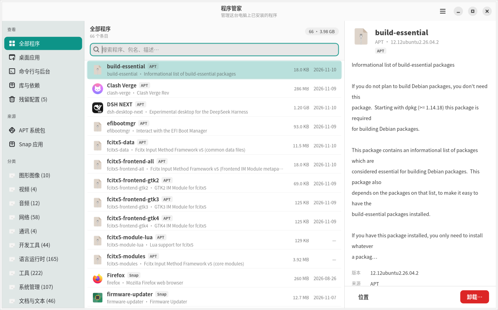
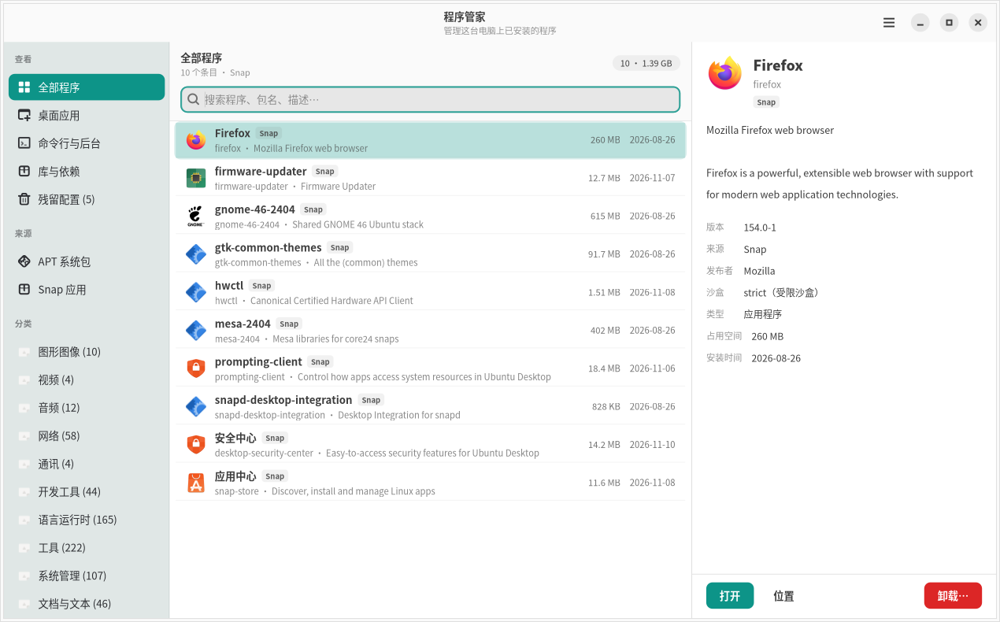
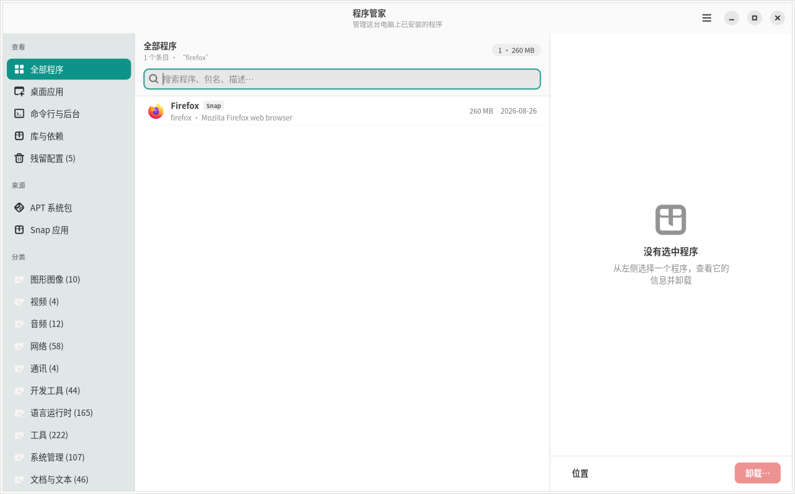
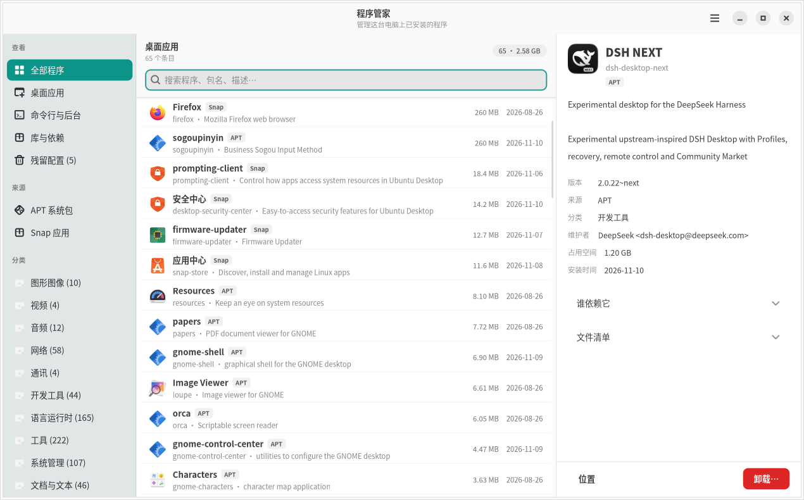

# 程序管家 · pakmanager

[](https://github.com/877007021/pakmanager/actions/workflows/ci.yml)
[](https://github.com/877007021/pakmanager/actions/workflows/release.yml)
[](LICENSE)

Linux 上的「已安装程序管理器」：**把已安装的东西列清楚，看清楚它占多大、什么时候装的、谁在依赖它，然后安全地卸载。**

Rust + GTK4 / libadwaita 原生应用，直接读 `dpkg` 和 `snapd` 的真实数据，不经过第三方服务。



---

## 为什么不是又一个包管理器

`apt` 面向「装」，这个工具面向「清理」。两者关注点不同，决定了几个设计取舍：

| 场景 | apt | 程序管家 |
| --- | --- | --- |
| 看装了什么 | `dpkg -l` 一屏滚不完 | 列表 + 搜索 + 分类，默认只看真正的程序 |
| 它占多大 | 无 | 按占用排序，顶部显示合计 |
| 什么时候装的 | 无 | 每行显示安装日期 |
| 能不能删 | 无 | 卸载前先预演，列出**会连带删掉哪些包** |
| 系统包防误删 | 无 | Essential/required 包标为「系统」并禁用卸载按钮 |
| 卸载残留 | 手动 | 「残留配置」分组，一键清理 |
| 依赖它的人 | `apt-cache rdepends` | 详情面板直接显示 |

## 界面

| 主界面 | 搜索过滤 |
| --- | --- |
|  |  |

| 详情面板 | 按来源筛选 |
| --- | --- |
|  |  |

## 功能

- **真实数据**：解析 `/var/lib/dpkg/status`（1.9 MB / 1900 个包约 30 ms），snap 走 snapd 的本地 REST socket
- **三种视角**：全部程序 / 桌面应用 / 命令行与后台 / 库与依赖 / 残留配置
- **按来源与分类筛选**：APT、Snap；40 个 dpkg section 收敛成十几个可读分类，带数量
- **搜索**：名字、描述、分类，支持多关键词
- **排序**：名称 / 占用空间 / 安装时间
- **详情面板**：版本、来源、维护者、占用、安装时间、谁依赖它、文件清单（展开才读）
- **卸载预演**：先跑 `apt-get -s remove`，把连带卸载的包名一次性列出来，包括「卸 gnome-shell 会带走 gdm3 和 ubuntu-session」这种
- **系统包保护**：Essential、`Priority: required`、`Protected: yes` 以及 dpkg/apt/libc6/systemd/snapd 禁用卸载
- **残留配置清理**：dpkg 状态 `rc` 的包单独成组
- **跟随系统主题**：明暗模式、GTK 缩放、高对比度

## 安全设计

卸载是本工具唯一的破坏性操作，因此：

1. **不做全系统 `autoremove`**。早期版本在「彻底删除」时顺带跑了 `apt-get autoremove --purge`，实测一次清掉了 32 个与目标包无关的系统依赖（fcitx5、libqt6*、libkf6* 等）。现在「彻底删除」只等于 `apt-get -y purge <pkg>`，依赖清理绝不隐式发生。有回归测试锁住这条（`uninstall_never_autoremoves`）。
2. **受保护包永不进入卸载流程**，按钮直接禁用并说明原因。
3. **先预演再执行**，对话框里写清楚会删哪些包、谁依赖它。
4. **明确区分**「仅卸载」（保留配置）和「同时删除配置」，默认焦点在「取消」上。

## 安装

### 方式一：下载构建好的产物

到 [Actions](https://github.com/877007021/pakmanager/actions/workflows/ci.yml) 里打开最近一次成功的
「构建 x86_64 产物」运行，在页面底部的 **Artifacts** 下载 `pakmanager-x86_64-linux`。
打标签发版后也可以直接从 [Releases](https://github.com/877007021/pakmanager/releases) 下载。

CI 在 Ubuntu 24.04 上构建（GTK 4.14 / libadwaita 1.5，即本项目要求的最低运行库版本），
因此产物在 24.04 及更新的发行版上都能直接运行。

```bash
tar -xzf pakmanager-x86_64-linux.tar.gz
cd pakmanager-x86_64-linux
sudo install -Dm755 pakmanager /usr/local/bin/pakmanager
sudo install -Dm644 dev.nanh.PakManager.desktop /usr/share/applications/dev.nanh.PakManager.desktop
```

### 方式二：从源码构建

```bash
# 依赖（一次性）
sudo apt install libgtk-4-dev libadwaita-1-dev build-essential pkg-config

# 构建
cargo build --release

# 装到系统
sudo install -Dm755 target/release/pakmanager /usr/local/bin/pakmanager
sudo install -Dm644 data/dev.nanh.PakManager.desktop /usr/share/applications/dev.nanh.PakManager.desktop
```

之后从应用菜单打开「程序管家」，或命令行运行 `pakmanager`。

### 关于提权

卸载需要 root。本工具使用 `sudo -n`（非交互），不会弹密码框：

- 你的账号已配置 `NOPASSWD: ALL`，因此直接可用
- 如果某台机器没有免密 sudo，卸载会失败并提示原因，不会挂起等待输入

## 命令行

```bash
pakmanager                     # 图形界面
pakmanager --dump              # 打印扫描统计（包数、受保护数、占用）
pakmanager --plan <包名>        # 预演卸载影响，只读
pakmanager --remove <包名>      # 执行卸载
pakmanager --remove <包名> --clean   # 卸载并删除配置（不含 autoremove）
```

## 开发

```bash
cargo test          # 14 个测试：dpkg 解析、snap JSON、日期、locale、卸载安全约束
cargo clippy --all-targets -- -D warnings
cargo fmt --check
cargo run
```

CI 会检查格式与 lints（警告即失败），并在 `C.UTF-8` 与 `zh_CN.UTF-8` 两种语言环境下各跑一遍测试
——桌面文件的本地化名字是随 `LANG` 变化的，只测一种会漏掉问题。

用自己的窗口截图做界面验证（不需要真实桌面会话）：

```bash
Xvfb :99 -screen 0 1280x800x24 &
DISPLAY=:99 PAKMANAGER_SHOT=/tmp/shots ./target/debug/pakmanager
```

会依次产出概览、详情、搜索、Snap 筛选等几张 PNG，并把控件里的实际文本与布局尺寸打到 stdout，便于在无显示器环境下核对。

## 代码结构

```
src/
  main.rs             入口、菜单动作、快捷键、命令行子命令
  model.rs            Package 模型、体积格式化、section → 中文分类
  util.rs             日期与文本截断
  system/
    mod.rs            扫描编排（后台线程）
    apt.rs            dpkg status / extended_states 解析、反向依赖、文件清单
    snap.rs           snapd REST（Unix socket 手写 HTTP）、日期解析、CLI 兜底
    desktop.rs        .desktop 解析（中文名、图标、可执行文件检查）
    ops.rs            卸载预演与执行
  ui/
    mod.rs            主窗口、三栏布局、筛选模型、扫描结果装配
    sidebar.rs        分组/来源/分类
    row.rs            列表行
    detail.rs         详情面板
    actions.rs        卸载确认、清理残留、启动程序
    style.rs          设计令牌与样式表
    probe.rs          无头截图与自检
```

## 已知限制

- 只支持 APT 与 Snap；Flatpak 尚未接入（本机未安装 flatpak，代码里留了目录位置）
- 安装时间取自 `/var/lib/dpkg/info/<pkg>.list` 的修改时间，是近似值
- 「库与依赖」视图默认折叠，避免 1800 个库淹没真正的程序
